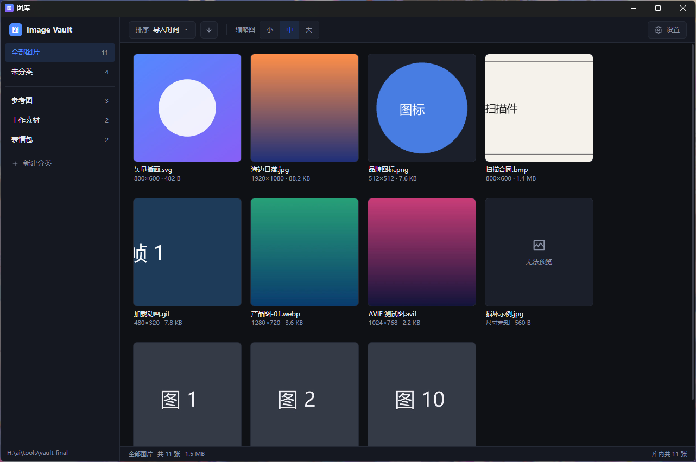

<div align="center">


# PickPic · Lightweight Image Manager

**A small, tidy box for your pictures.**

A local, offline Windows image manager — drag in, organize, drag out when you need it.

[](https://github.com/jiuhui346/pickpic/releases)
[](https://github.com/jiuhui346/pickpic/releases)
[](https://tauri.app)
[](https://github.com/jiuhui346/pickpic)

[简体中文](./README.md) · [English](./README.en.md)

</div>



## Why PickPic

- **Light** — no runtime, no account, no network. The installer is under 5 MB and idle memory is about 85 MB.
- **Fast** — with 10,000 images, scrolling averages 6.1 ms per frame (P95 6.9 ms); cold start is about 1.1 s.
- **Local** — images, thumbnails and metadata live in a folder you choose. Copy the folder to back up or move machines.
- **Extensible** — a built-in MCP server and plugin system keep the core small while features grow as plugins.

## Features

- **Drag-in import** — drop images or folders from Explorer; move or copy, rename one by one or import in bulk.
- **Duplicate detection** — BLAKE3 content hashes warn you before importing an identical image; skip it or keep it.
- **Categories + tags** — categories decide where an image lives; tags filter inside a category and reset to "no filter" after restart.
- **Thumbnail grid** — virtual scrolling, 512 px cache, small/medium/large; optionally play GIF and animated WebP thumbnails.
- **Selection and drag-out** — click to select, click again to deselect, Ctrl-drag to sweep, drag a whole group to Explorer, WeChat, Photoshop or any folder.
- **Safe deletion** — right-click or press `Delete`, with confirmation; batch operations supported.
- **MCP server** — local HTTP + stdio so agents can import, rename, delete, export, manage categories/tags and change settings.
- **Plugin system** — `plugin.json` + `main.js`; install plugins from a GitHub-hosted index inside the app.
- **Interface** — dark/light/system theme, compact mode, custom shortcuts, vault migration.

## Download

> [!NOTE]
> Installers are published on [GitHub Releases](https://github.com/jiuhui346/pickpic/releases).
> First time here? Read the [user guide](docs/使用说明.md) (Chinese).

| File | Notes |
| --- | --- |
| `PickPic_1.0.12_x64-setup.exe` | NSIS installer, recommended |
| `PickPic_1.0.12_x64_en-US.msi` | MSI installer for managed deployment |

Requirements: Windows 10 / 11 (x64) with WebView2 Runtime (bundled with Windows 11; usually present on Windows 10 via Edge).

## Quick start

1. Install and open PickPic, then choose a storage folder (for example `D:\Pictures\PickPic`).
2. Drag images from Explorer into the window; pick a category and tag in the naming dialog, then press Enter.
3. Create categories in the sidebar, filter by tags in the toolbar, and right-click an image to categorize, tag or delete it.
4. Drag images out to another app or folder whenever you need them.

> Import defaults to **move** (the original leaves its old location); drag-out defaults to **copy** (the library keeps its copy). Both can be changed in Settings → General.

## Plugins

Plugins keep the core small and let features arrive on demand:

1. Settings → Plugins → Online plugin source, enter:
   `https://fastly.jsdelivr.net/gh/jiuhui346/pickpic@main/plugins/index.json`
2. Click "Save and refresh", then "Install" next to a plugin.
3. Plugins are disabled after installation; enable one and click "Reload" to activate it.

See [plugins/README.md](plugins/README.md) for the plugin format and API. The global API object is `PickPic`; the legacy `ImageVault` alias is still supported.

## MCP

Settings → MCP, then enable the service:

- HTTP: `http://127.0.0.1:45871/mcp` (Bearer token; copy the config from Settings)
- stdio: `pickpic.exe --mcp-stdio` (for agents that only support command-line servers)

The server listens on loopback only and exposes the same image, category, tag and settings operations as the UI.

## Build from source

Prerequisites: Node.js 18+, Rust (rustup + MSVC), NASM, WebView2 Runtime.

```powershell
npm install
npm run app:dev      # development
npm run build        # package msi + nsis
```

The build scripts set `CARGO_TARGET_DIR=%LOCALAPPDATA%\pickpic-build` and add NASM to PATH.
Do not run `npm run tauri build` directly: NASM cannot write to a non-ASCII target path when the project path contains Chinese characters.

## Project layout

```
pickpic/
├─ src/              React frontend
├─ src-tauri/        Rust / Tauri backend
├─ plugins/          Online plugin index and plugin folders
├─ docs/             User guide
├─ scripts/          Build and dev scripts
└─ release/          Installer output (git-ignored)
```

Vault layout:

```
<vault folder>/
├─ vault.db          SQLite (images, categories, tags, settings)
├─ thumbs/           Thumbnail cache
└─ images/2026/10/   Original files, grouped by import month
```

## FAQ

- **"Storage folder unavailable" at startup** — the folder was moved/deleted or the drive is disconnected. Pick it again; records are kept.
- **"File is in use" when importing** — close the file in its current app and retry.
- **"Cannot preview"** — the image is corrupt or exceeds the decode limit; the original can still be dragged out.
- **"Unknown publisher" in the installer** — the installer is currently unsigned; this is expected.
- **Plugin source fails to load** — make sure the URL ends with `/plugins/index.json`, the repository is public, and jsDelivr has refreshed its cache.

## Documentation

- [User guide (Chinese)](docs/使用说明.md)
- [Plugin format](plugins/README.md)
